# FintechCore · Pipeline de scoring des impayés sur Dataiku DSS


> Pipeline de données **automatisé** qui prépare l'historique des clients d'un organisme de crédit, calcule des indicateurs de retard de paiement, entraîne un modèle de détection des impayés et envoie chaque semaine une alerte sur les clients à haut risque.


---

## Sommaire

1. [Contexte et objectif](#1-contexte-et-objectif)
2. [Résultats clés](#2-résultats-clés)
3. [Architecture du pipeline](#3-architecture-du-pipeline)
4. [Les données](#4-les-données)
5. [Étape 1 · Ingestion et préparation](#5-étape-1--ingestion-et-préparation-recettes-visuelles)
6. [Étape 2 · Enrichissement en Python](#6-étape-2--enrichissement-et-logique-métier-recette-python)
7. [Étape 3 · Modélisation et scoring](#7-étape-3--modélisation-et-scoring-automl)
8. [Étape 4 · Automatisation](#8-étape-4--automatisation-scénario)
9. [Limites et pistes d'amélioration](#9-limites-et-pistes-damélioration)
10. [Structure du dépôt](#10-structure-du-dépôt)
11. [Reproduire le projet](#11-reproduire-le-projet)

---

## 1. Contexte et objectif

**FintechCore**, une entreprise (fictive) de crédit à la consommation, veut **détecter automatiquement les clients susceptibles de ne pas rembourser** leur crédit, pour les contacter avant que l'impayé ne s'aggrave.

Les données viennent de deux sources :
- une **base relationnelle** de profils clients (`clients_db`) ;
- des **fichiers CSV** d'historique des paiements déposés quotidiennement (`transactions_csv`).

L'objectif est un **Flow Dataiku modulable et réutilisable**, qui combine :
- des **recettes visuelles** (Join, Prepare) ;
- du **code Python** pour la logique métier ;
- un modèle **AutoML** de classification ;
- un **scénario** qui automatise toute la chaîne et envoie une alerte.

---

## 2. Résultats clés

| Indicateur | Valeur |
|---|---|
| Clients analysés | 1 200 (dont 1 023 pour l'entraînement, 177 à scorer) |
| Transactions traitées | 10 792 |
| Meilleur modèle | **Random Forest**, AUC = **0,837** (contre 0,776 pour XGBoost) |
| Rappel (défauts détectés) | **75 %** des clients en défaut repérés sur le jeu de test |
| Clients à haut risque détectés | **21 sur 177** nouveaux clients (probabilité de défaut ≥ 0,5) |
| Exécution complète du pipeline | **≈ 10 secondes** |
| Fréquence d'exécution | Automatique, **chaque lundi à 06:00** |

---

## 3. Architecture du pipeline

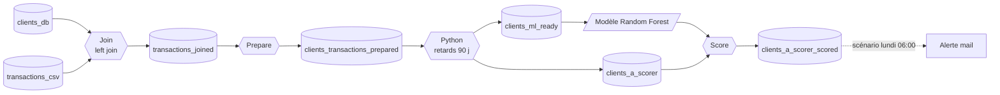

| Couche | Datasets | Rôle |
|---|---|---|
| **Sources** | `clients_db`, `transactions_csv` | Données brutes |
| **Préparation** | `transactions_joined`, `clients_transactions_prepared` | Jointure, typage, nettoyage, variables calculées |
| **Enrichissement** | `clients_ml_ready`, `clients_a_scorer` | Une ligne par client, indicateurs métier, séparation entraînement / scoring |
| **Prédiction** | `clients_a_scorer_scored` | Prédiction et probabilité de défaut par client |

---

## 4. Les données

Les données sont **synthétiques**, générées par [`src/generate_data.py`](src/generate_data.py) avec une graine aléatoire fixe. Elles sont donc fictives et reproductibles. Elles imitent des cas réels : valeurs manquantes, format de date français, séparateur `;`, classes déséquilibrées.

**`clients_db.csv`**, 1 200 lignes, une par client :

| Colonne | Description |
|---|---|
| `client_id` | Identifiant unique du client (clé de jointure) |
| `age` | Âge du client (≈ 8 % de valeurs manquantes) |
| `revenu_annuel` | Revenu annuel en euros |
| `type_contrat` | CDI, CDD, Indépendant, Intérim, Retraité |
| `region` | Région de résidence |
| `anciennete_mois` | Ancienneté du client en mois |
| `nb_credits_actifs` | Nombre de crédits en cours |
| `montant_credit` | Montant total emprunté |
| `montant_impaye` | Montant actuellement impayé |
| `defaut_paiement` | **Cible** : 1 = défaut, 0 = pas de défaut, vide = nouveau client à scorer |

**`transactions_csv.csv`**, 10 792 lignes, une par échéance (séparateur `;`) :

| Colonne | Description |
|---|---|
| `transaction_id` | Identifiant de l'échéance |
| `client_id` | Identifiant du client |
| `transaction_date` | Date de l'échéance (format `dd/MM/yyyy`) |
| `montant_echeance` | Montant de l'échéance |
| `statut_paiement` | PAYE, RETARD ou IMPAYE |
| `jours_retard` | Nombre de jours de retard |

---

## 5. Étape 1 · Ingestion et préparation (recettes visuelles)

### Join

Les transactions sont jointes aux profils clients sur `client_id` avec un **left join**, transactions à gauche.

- **Pourquoi un left join ?** Aucune transaction ne doit être perdue, même si un profil client venait à manquer.
- **Contrôle :** le nombre de lignes reste à **10 792** après la jointure, ce qui confirme que `client_id` est bien unique côté clients et qu'aucune ligne n'a été dupliquée.

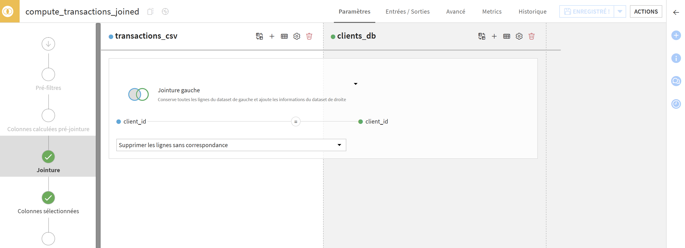

### Prepare

| Étape | Traitement | Justification |
|---|---|---|
| 1 | **Parse date** de `transaction_date` (`dd/MM/yyyy` → date) | Rendre la date exploitable pour la fenêtre de 90 jours |
| 2 | **Imputation de l'âge par la médiane** (47 ans) | La médiane résiste aux valeurs extrêmes, contrairement à la moyenne |
| 3 | **Formule** `dette_ratio = montant_impaye / revenu_annuel` | Mesure le poids de la dette dans les revenus du client |

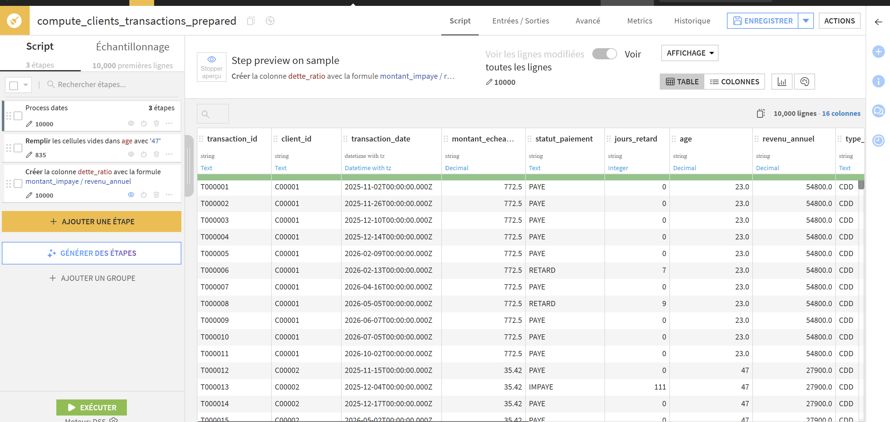

> 💡 La variable `dette_ratio` créée ici arrive en **2ᵉ position** dans l'importance des variables du modèle final.

---

## 6. Étape 2 · Enrichissement et logique métier (recette Python)

Code : [`src/recette_python_retards_90j.py`](src/recette_python_retards_90j.py)

La recette Python fait l'équivalent de **trois recettes visuelles** :

| Bloc | Équivalent visuel | Ce qu'il fait |
|---|---|---|
| Fenêtre glissante | **Window** | Pour chaque transaction, compte les retards du client sur les **90 jours précédents** (`rolling("90D")`) |
| Agrégation | **Group** | Une ligne par client : `nb_retards_90j`, `nb_retards_total`, `jours_retard_moyen`, `jours_retard_max`, `taux_retard_90j`… |
| Séparation | **Split** | `clients_ml_ready` (cible connue, 1 023 clients) / `clients_a_scorer` (cible inconnue, 177 clients) |

**Pourquoi Python plutôt qu'une recette Window ?** La fenêtre est basée sur une **durée** (90 jours) et non sur un nombre de lignes. C'est plus simple et plus lisible à écrire avec pandas.

Le script **convertit aussi les colonnes numériques**, car les CSV importés sont stockés en `string` par Dataiku.

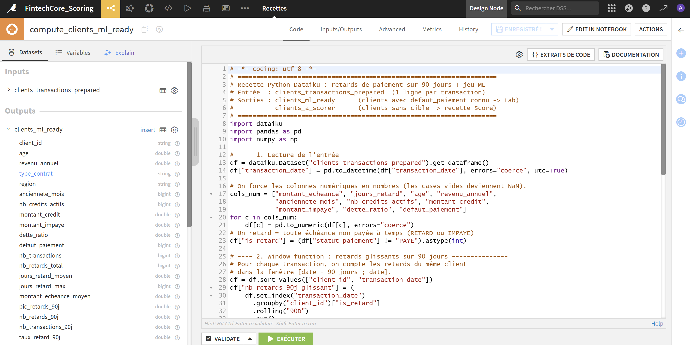

---

## 7. Étape 3 · Modélisation et scoring (AutoML)

### Paramétrage

| Paramètre | Choix | Justification |
|---|---|---|
| Type | Classification binaire | Cible `defaut_paiement` = 0 ou 1 |
| Variables | 18 variables explicatives | `client_id` **rejeté** : un identifiant n'a aucune valeur prédictive |
| Algorithmes | Random Forest vs XGBoost | Deux familles d'arbres de décision (bagging vs boosting) |
| Métrique optimisée | **AUC-ROC** | Mesure la capacité à classer les clients risqués avant les autres, quel que soit le seuil |
| Pondération | **Class weights** | Seulement ≈ 10 % de défauts : sans pondération, le modèle ignorerait la classe minoritaire |
| Découpage | 80 % entraînement (824) / 20 % test (199) | Évaluation sur des clients jamais vus par le modèle |

### Comparaison des modèles

| Modèle | AUC |
|---|---|
| **Random Forest** 🏆 | **0,837** |
| XGBoost | 0,776 |

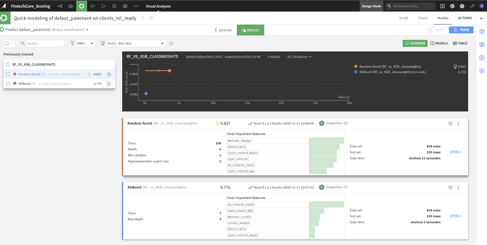

### Performance du Random Forest (jeu de test, 199 clients)

| | Prédit défaut | Prédit pas de défaut | Total |
|---|---|---|---|
| **Défaut réel** | 15 ✅ | 5 ❌ | 20 |
| **Pas de défaut réel** | 29 ❌ | 150 ✅ | 179 |

| Métrique | Valeur | Lecture |
|---|---|---|
| Accuracy | 83 % | Part des prédictions correctes |
| **Recall** | **75 %** | 15 des 20 clients en défaut sont détectés |
| Precision | 34 % | 15 des 44 alertes sont de vrais défauts |
| F1-score | 47 % | Équilibre entre précision et rappel |

**Interprétation métier :** le modèle privilégie le **rappel**. Il préfère lancer des alertes en trop (29 faux positifs) plutôt que rater de vrais défauts. Pour un organisme de crédit, appeler un client qui n'est pas à risque coûte beaucoup moins cher qu'un crédit non remboursé.

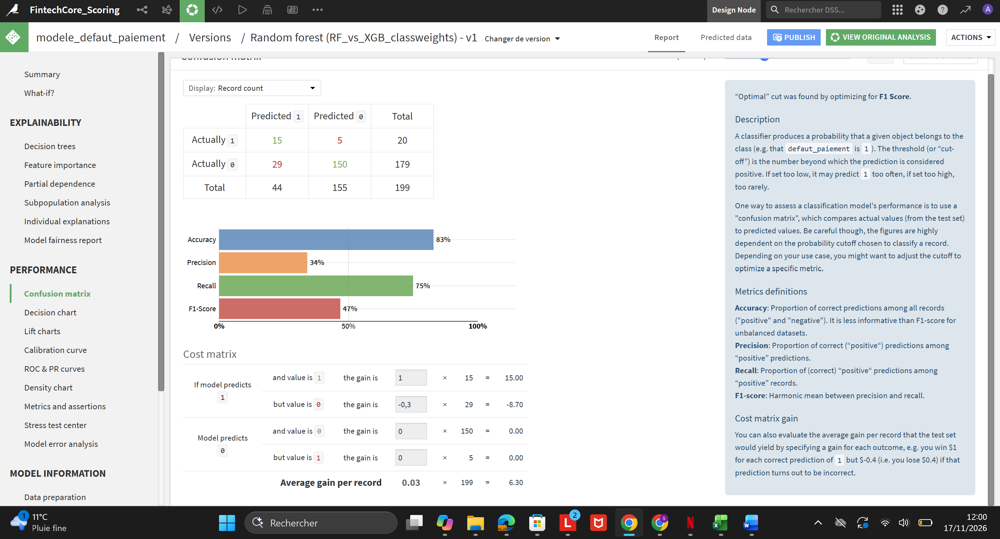

### Variables les plus importantes

1. `montant_impaye`
2. `dette_ratio` *(variable créée dans le Prepare)*
3. `jours_retard_moyen`
4. `type_contrat`
5. `nb_retards_total`
6. `jours_retard_max`

<p align="center">
  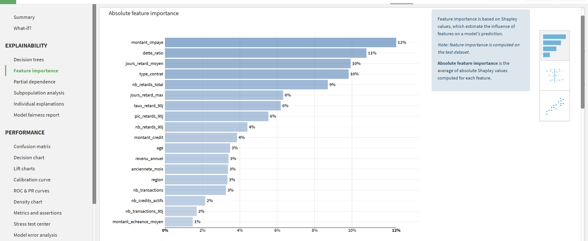
  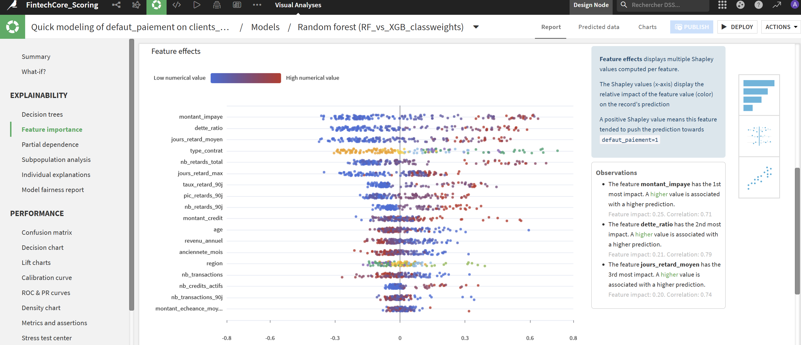
  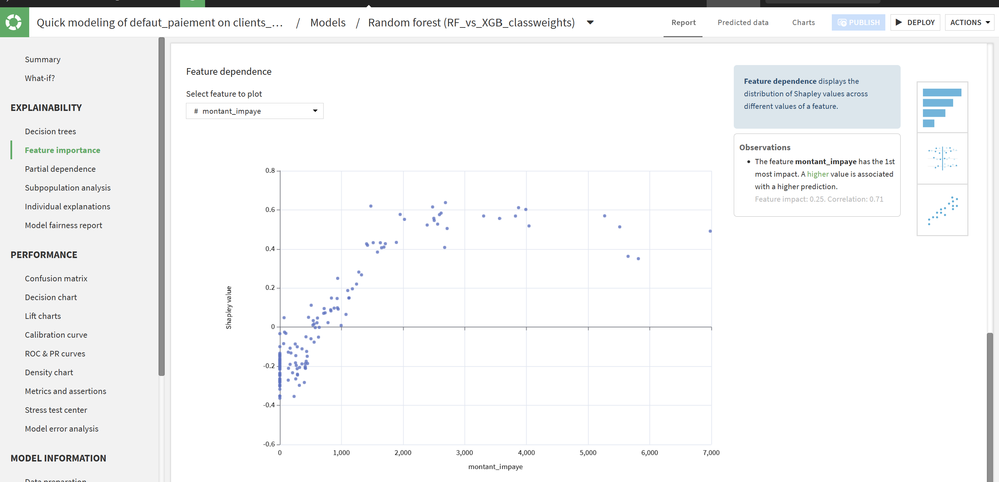
</p>

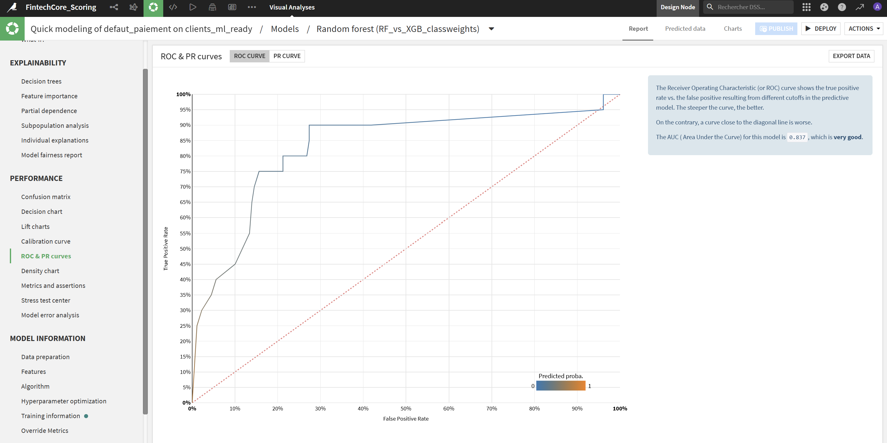

### Déploiement et scoring

Le Random Forest est **déployé dans le Flow** (`modele_defaut_paiement`), puis une **recette Score** l'applique aux 177 nouveaux clients. La sortie `clients_a_scorer_scored` contient :
- `prediction` : 0 ou 1 ;
- `proba_0` : probabilité de remboursement ;
- `proba_1` : **probabilité de défaut**, utilisée comme score de risque.

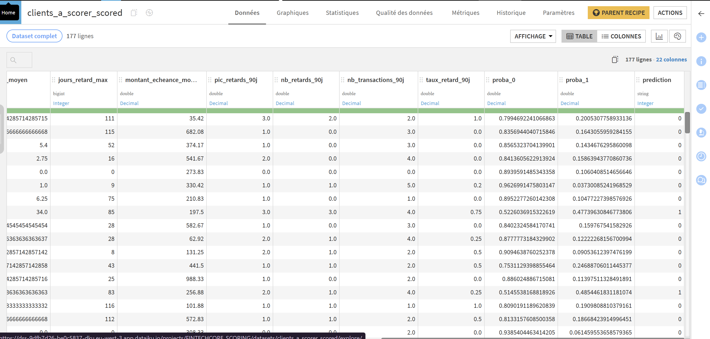

---

## 8. Étape 4 · Automatisation (scénario)

Scénario **`Pipeline_hebdo`** :

| Élément | Configuration |
|---|---|
| **Étape 1 : Build** | Reconstruit `clients_a_scorer_scored` et ses dépendances en amont (Join → Prepare → Python → Score) |
| **Étape 2 : Python** | [`src/etape_scenario_alerte.py`](src/etape_scenario_alerte.py) compte les clients avec `proba_1 ≥ 0,5` et stocke le résultat dans des variables de scénario |
| **Trigger** | Basé sur le temps : **chaque lundi à 06:00** (Europe/Paris) |
| **Reporter** | Mail d'alerte en fin de scénario, avec les variables `${nb_haut_risque}`, `${nb_clients_scores}` et `${seuil_risque}` |

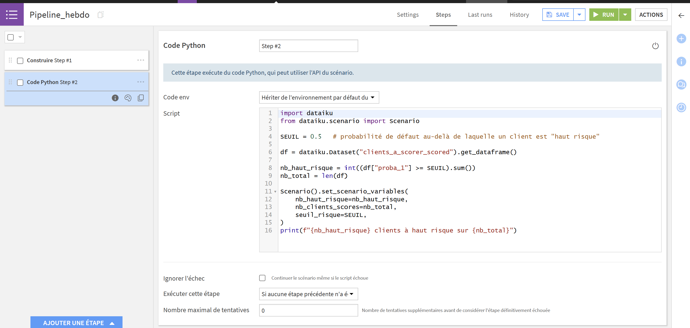
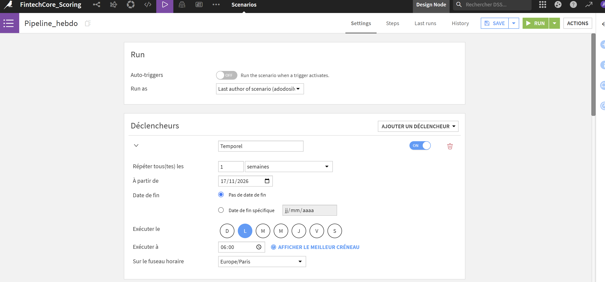
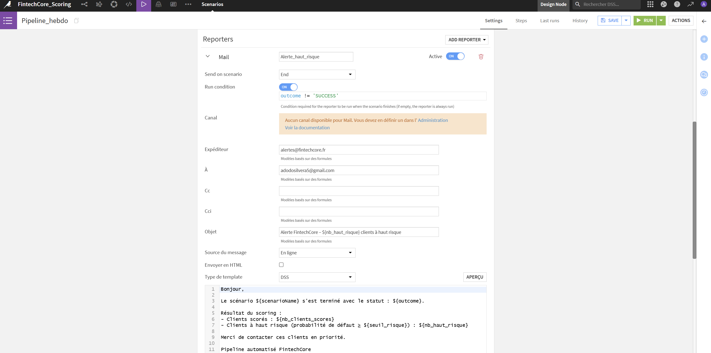

**Message d'alerte :**
```
Le scénario Pipeline_hebdo s'est terminé avec le statut : SUCCESS.

Résultat du scoring :
- Clients scorés : 177
- Clients à haut risque (probabilité de défaut ≥ 0.5) : 21

Merci de contacter ces clients en priorité.
```

**Exécution :** les deux étapes sont terminées avec succès en **10 secondes**, avec **21 clients à haut risque sur 177**.

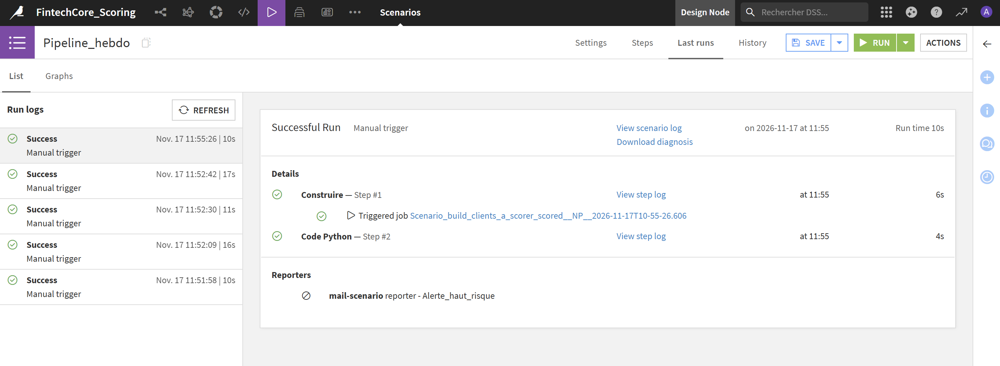

> ℹ️ L'envoi du mail est **simulé** : l'instance d'essai Dataiku Cloud n'a pas de canal SMTP. En production, le canal mail de l'entreprise serait configuré dans *Administration → Paramètres → Notifications*.

---

## 9. Limites et pistes d'amélioration

**Limites**
- **Fuite de données possible :** `montant_impaye` est la variable la plus prédictive. Dans un contexte réel, il faudrait vérifier qu'elle est connue **avant** le défaut et non mesurée après, sinon le modèle exploiterait une information du futur.
- **Données synthétiques** et volume réduit (1 023 clients pour l'entraînement) : les performances ne sont pas transposables telles quelles.
- **Seuil d'alerte fixé à 0,5**, alors que Dataiku a calculé un seuil optimal sur le F1-score. Les deux devraient être alignés.
- La médiane d'imputation de l'âge est calculée sur la table jointe (une ligne par transaction) : un client avec beaucoup de transactions pèse davantage.

**Pistes d'amélioration**
- Aligner le seuil d'alerte du scénario sur le seuil optimal du modèle, ou le définir avec le métier à l'aide de la **matrice de coûts**.
- Ajouter des **règles de qualité des données** (unicité de `client_id`, fraîcheur des transactions) qui bloquent le scénario en cas d'anomalie.
- Ajouter un trigger sur la **modification du dataset** `transactions_csv`, en plus du trigger hebdomadaire.
- Mettre en place le **suivi de la dérive** du modèle et un réentraînement périodique.
- Brancher la vraie base PostgreSQL et un stockage objet (S3) à la place des fichiers uploadés.
- Exposer les résultats dans un **tableau de bord Power BI** pour les équipes de recouvrement.

---

## 10. Structure du dépôt

```
fintechcore-dataiku-scoring/
├── README.md                          # Ce document
├── .gitignore
├── data/
│   ├── clients_db.csv                 # Profils clients (1 200 lignes)
│   └── transactions_csv.csv           # Historique des échéances (10 792 lignes)
├── src/
│   ├── generate_data.py               # Génération des données synthétiques
│   ├── recette_python_retards_90j.py  # Recette Python (étape 2)
│   └── etape_scenario_alerte.py       # Étape Python du scénario (étape 4)
├── images/                            # Captures d'écran du projet
└── dataiku_export/
    └── FINTECHCORE_SCORING.zip        # Export complet du projet Dataiku
```

---

## 11. Reproduire le projet

1. **Régénérer les données** (facultatif, elles sont déjà dans `data/`) :
   ```bash
   pip install pandas numpy
   python src/generate_data.py
   ```
2. **Importer le projet** dans Dataiku DSS : page d'accueil → **+ Nouveau projet → Importer un projet** → sélectionner `dataiku_export/FINTECHCORE_SCORING.zip`.
3. Ou **le reconstruire pas à pas** en suivant les étapes 5 à 8 de ce document.

**Environnement :** Dataiku Cloud (DSS 15.2), environnement Python par défaut (pandas, numpy).

---

## Compétences mobilisées

`Dataiku DSS` · `Recettes visuelles (Join, Prepare)` · `Python / pandas` · `Window functions` · `AutoML` · `Classification binaire` · `Évaluation de modèle (AUC, rappel, matrice de confusion)` · `Scénarios et automatisation` · `Documentation`

---

## Auteur

**Silvère ADODO-DAHOUE**, Data Analyst BI, en évolution vers l'Analytics Engineering
Certifié **Dataiku Core Designer**

[LinkedIn](https://www.linkedin.com/in/VOTRE-PROFIL)
